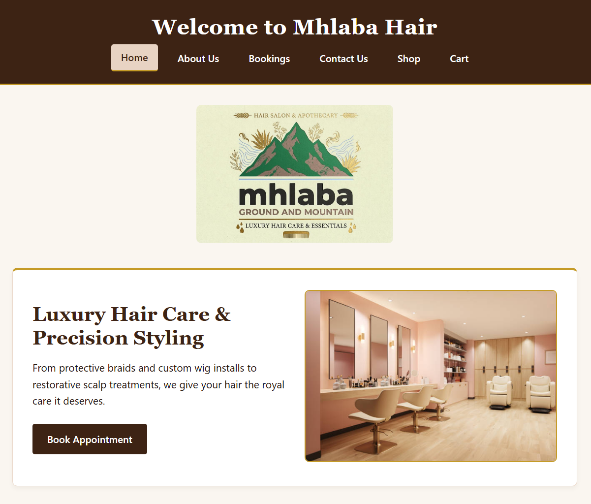
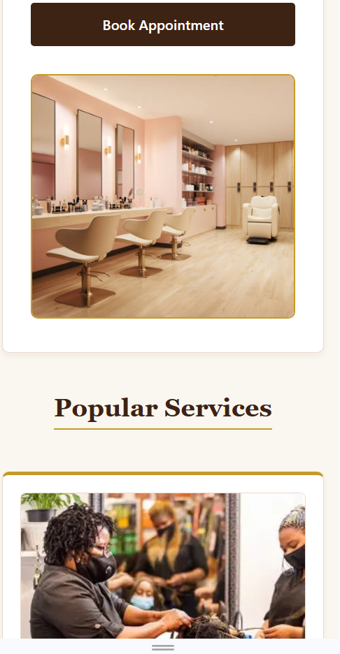
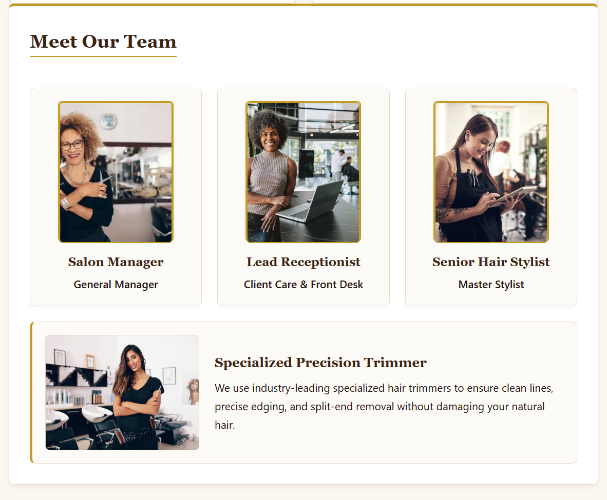
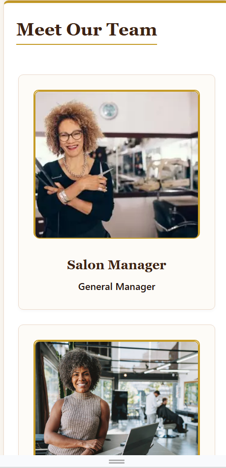
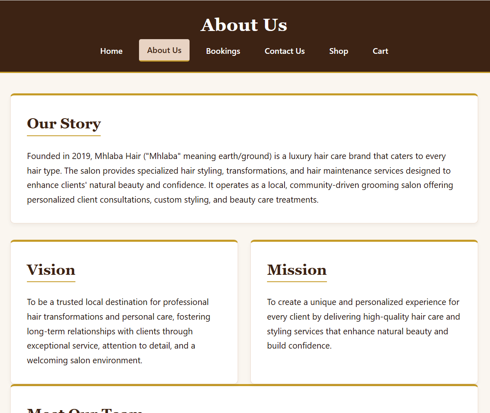
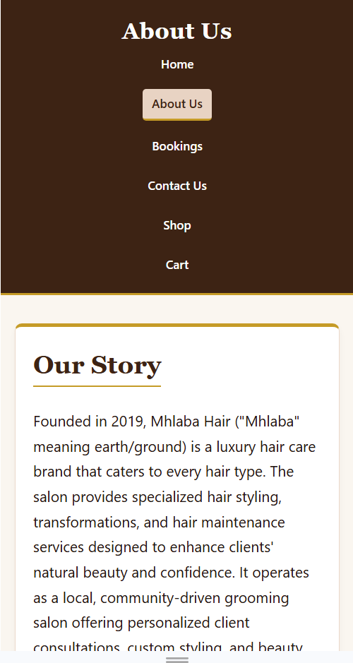

# Mhlaba Hair - Part 2 Final Submission

Student Name: Naledi Maseko  
Module: WEDE5020 - Web Development (Part 2)  
Repository: `wede5020-2026-part-2-naledi-maseko`  
Target Audience: Luxury client base seeking high-end natural hair styling, maintenance, and salon booking services.

1. Executive Summary & Part 2 Project Scope

Mhlaba Hair ("Mhlaba" meaning earth/ground) is a luxury hair care brand providing specialized hair styling, transformations, and maintenance services. Part 2 builds upon the structural foundation established in Part 1 by incorporating full CSS layout refinements, mobile-first responsive design, interactive forms, and media optimization.

 Key Features Implemented in Part 2:
Responsive Layout Architecture: Implemented CSS Grid and Flexbox with media queries across breakpoints (`768px`, `480px`) to transition seamless desktop multi-column layouts into mobile-friendly single-column stacks.
HTML5 Form Validation & File Uploads: Integrated secure booking forms with native HTML5 input attributes (`required`, `type="date"`, `type="email"`) and enabled client file uploads (`enctype="multipart/form-data"`).
Responsive Images (`<picture>` Element): Implemented `<picture>` wrappers with `srcset` attributes and lazy loading (`loading="lazy"`) to optimize image bandwidth and rendering speed across different device resolutions.
Cohesive Brand Palette:** Styled using CSS root variables leveraging the luxury Espresso (`#3D2314`), Gold (`#D4AF37`), and Champagne (`#F9F6F0`) color palette.

2. Technical Stack & Structure

Markup: HTML5 (Semantic elements: `<header>`, `<nav>`, `<main>`, `<section>`, `<article>`, `<picture>`, `<footer>`)
Styling: CSS3 (Flexbox, CSS Grid, Media Queries, CSS Custom Properties/Variables, Relative Units `rem`/`em`/`%`)
Version Control: Git & GitHub Classroom Workflow

3. Changelog

Part 2 Enhancements & Part 1 Feedback Edits

Feedback Refinements (Carried from Part 1 Grading)
Navigation & Header Alignment: Refactored the main header structure to align the brand logo (`border-radius: 50%` circular cropped image) alongside the welcome heading dynamically using Flexbox.
Accessibility & Validation: Fixed unencoded ampersands across HTML content files (`&amp;`) to pass strict W3C HTML validation checks. Added explicit `alt` text and `aria-label` attributes to image elements and interactive controls.
Relative Units: Replaced static pixel dimensions in body layouts with relative units (`rem`, `%`, `vw`) to ensure flexible scaling across variable viewports.

 Part 2 New Features & Optimizations
Responsive Image Optimization: Applied `<picture>` tags with media-conditioned `srcset` values for team members and specialized equipment cards.
Team & Service Cards Responsiveness: Added `grid-template-columns: repeat(auto-fit, minmax(220px, 1fr))` alongside `@media (max-width: 768px)` flex-column overrides to stop team cards from horizontal squishing on mobile screens.
Interactive Contact & Booking: Redesigned contact card layouts with centered SVG icons and expanded form controls for seamless appointment requests.

4. Testing & Browser Compatibility

The website has been tested and verified across multiple screen resolutions using Chrome and Microsoft Edge Developer Tools (Device Toolbar):
Desktop Viewport (>1024px): Displays 3-column team grid, side-by-side equipment feature cards, and horizontal top navigation bar.
Mobile Viewport (<768px / 375px iPhone SE/12): Features 1-column vertically stacked team profiles, collapsible wrapped navigation buttons, and responsive image scaling without horizontal scrollbars.

5. Visual Showcase & Screenshots

Desktop vs Mobile Layout Comparison

| Desktop View | Mobile View |
|  |  |
|  |  |
|  |  |

6. References (IIE Anglo-Harvard)

* MDN Web Docs. 2026. *The Picture element*. Available at: <https://developer.mozilla.org/en-US/docs/Web/HTML/Element/picture> [Accessed 4 October 2026].
* MDN Web Docs. 2026. *Using CSS media queries*. Available at: <https://developer.mozilla.org/en-US/docs/Web/CSS/CSS_media_queries/Using_media_queries> [Accessed 1 October 2026].
* W3C. 2026. *CSS Flexible Box Layout Module Level 1*. World Wide Web Consortium. Available at: <https://www.w3.org/TR/css-flexbox-1/> [Accessed 5 October 2026].
* W3C. 2026. *HTML5 Accessibility Chokepoints and Guidelines*. World Wide Web Consortium. Available at: <https://www.w3.org/TR/html-a11y-guidelines/> [Accessed 5 October 2026].